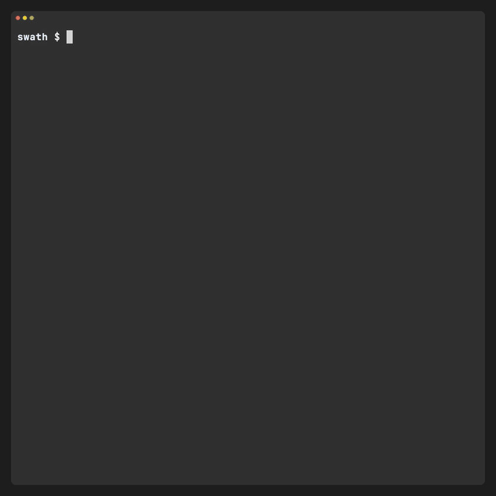

[](https://github.com/varveio/swath/actions/workflows/ci.yml)

# swath

**Parallel listing and inventory for large object stores and filesystems.**

swath is an open-source command-line tool that lists files and objects in local and mounted
filesystems, S3, GCS, and Azure Blob Storage (flat namespace). It can summarize sizes by
directory or prefix (`du`) and write sorted Parquet inventories.

> **Go on main, unreleased:** this page describes the Go implementation. The latest
> published release is [Java v0.3.2](https://github.com/varveio/swath/releases/tag/v0.3.2),
> the S3-focused CLI. Build Go from source to use the commands and backends below.
> Go will replace Java at release; Java has not been removed yet.

## Measured scale

On 2026-11-07, build `bf5e6d52` listed and counted **1,088,794,418 objects in 177 seconds**
in the public `sentinel-cogs` S3 bucket, without writing an inventory. A **separate run
wrote sorted Parquet in 846 seconds** (14 minutes 6 seconds). Both used 1,024 workers on
one 32-vCPU `n4-highcpu-32` VM with a 400 GB disk in GCP `us-east1`, listing anonymously
across clouds from AWS `us-west-2`.

These are single-run S3 observations, not expected times for every source or machine.
The [measurements and setup](go/docs/internals/measurements.md) keep the operations, conditions and
other runs separate.

## Supported sources

This table describes **Go on main**, not the Java release.

| Source | Listing and summaries | Limits |
| --- | --- | --- |
| Local and mounted filesystems | Sorted Parquet inventory; direct `du` summaries | Listing rows require `-o DIR`. No scan resume. Mounted shares use the OS filesystem, not a native NFS or SMB client. |
| Amazon S3 | Text or dataset listing; prefix totals; eligible dataset resume | General-purpose buckets, not directory buckets. `--all-versions` lists versions and delete markers. Check S3-compatible endpoints separately. |
| Google Cloud Storage | Native `gs://` listing; prefix totals; eligible dataset resume | `--all-versions` lists live and noncurrent generations. Their metadata differs from S3 versions. |
| Azure Blob Storage | `az://` listing; prefix totals; eligible dataset resume | Flat namespaces and current blobs only. Hierarchical namespaces and Azure version listing are unsupported. |

Eligible journaled object-store dataset scans can resume. Local scans and text output
cannot. Windows currently refuses journaled object-store runs and `swath resume` because
directory sync is unavailable; local scans work without resume. See
[platform and recovery limits](go/docs/running.md#known-limits).

<a id="quickstart"></a>

## Quick start

**Build the unreleased Go implementation** with Go 1.26 (the toolchain version is in
[`go/go.mod`](go/go.mod)). The published Java downloads and container do not provide
these commands and backends.

```bash
git clone https://github.com/varveio/swath.git
cd swath/go
./build.sh -o swath
./swath --version
```

### Summarize a local tree

```bash
./swath du /data -d 2
```

Replace `/data` with a directory to inspect. This prints counts and apparent sizes by
directory, two levels below the root, without writing an inventory. Local
`--allocated` and `--count-links-once` options select allocated bytes and count hard-linked
files once where platform metadata supports them. These are size summaries, not a bill.

### Print an object-store listing

This small public NOAA prefix needs no cloud account:

```bash
./swath list s3://noaa-gestofs-pds/stofs_2d_glo.20230113/ \
  --anonymous --s3-region us-east-1
```

Object-store listings go to the terminal or a pipe as text. GCS and Azure Blob use the
same `list` command with their own source and authentication options. Cloud listings make
provider requests and may incur charges; read the [operating guide](go/docs/running.md)
before a large or requester-pays scan.

### Keep an inventory

```bash
./swath list /data -o /tmp/swath-inventory
./swath show /tmp/swath-inventory
```

The destination must be new or empty and should be outside the tree being scanned. Local
listings require a dataset destination. `swath show` prints its summary, not SQL results.
A swath dataset is a directory of sorted Parquet parts and a `manifest.json` that commits
them, in the [SeekParquet format](https://github.com/varveio/seekparquet), with a swath
schema and metadata ([dataset profile](go/docs/dataset.md)). Read it with DuckDB, Python
or another Parquet tool, after checking coverage and schema.

## Output and resume

- `swath du` prints directory or prefix totals as a terminal table, TSV or JSONL.
- Object-store `list` can print rows or write TSV/JSONL files, optionally compressed.
- Dataset output is globally key-sorted Parquet, with a manifest and coverage information.
- `swath resume DIR` continues eligible interrupted S3, GCS or Azure Blob dataset scans.
  It retains durable work and may repeat listing beyond the durable recovery point.

swath reads listing metadata and does not change source contents. A live walk or
multi-request listing is not an atomic storage snapshot. Check coverage, filters,
entry errors and freshness before treating the result as a whole-source inventory.
The [Go guide](go/docs/getting-started.md) explains these choices; the
[operating reference](go/docs/running.md) owns recovery and resource limits.

## When to use it

Use swath when listing itself takes too long, when you need directory or prefix totals,
or when another workflow needs a reusable inventory. An ordinary `find` or `du`, a small
one-off cloud listing, or a sufficiently fresh provider inventory may already answer the
question.

Inventories can feed migration planning, SQL/Python analysis, version inspection, or
periodic comparisons. Scheduling, transfers, diffing, backup validation, alerts and
archive creation belong to other tools or application code. swath produces listings and
inventories; Varve adds context and exploration around storage. Check an integration's
supported schemas rather than assuming every swath dataset is accepted.

## Documentation

- **Start:** [Go guide](go/docs/getting-started.md), [build and verify](go/docs/running.md#install-and-verify).
- **Use:** [command reference](go/docs/commands/swath.md), [operating guide](go/docs/running.md),
  [production checklist](go/docs/production.md).
- **Read the output:** [swath dataset profile](go/docs/dataset.md).
- **Understand:** [architecture](go/docs/internals/architecture.md), [providers](go/docs/internals/providers.md),
  [measurements](go/docs/internals/measurements.md).
- **Move from Java:** [migration guide](go/docs/from-java.md) and [dataset changes](go/docs/upgrade.md).
- **Java v0.3.2:** [release documentation](https://github.com/varveio/swath/tree/v0.3.2/docs)
  and [historical visual field guide](https://swath.varve.io/field-guide/).
- **Contribute:** [contribution guide](CONTRIBUTING.md), [Go tests](go/docs/internals/testing.md),
  [roadmap](ROADMAP.md).

swath is pre-1.0. Flags and schemas can change; keep the build revision with inventories
and run reports. Go is being prepared to replace Java, not become a second maintained
edition.

## See it at full scale

The recordings below are **historical Java evidence**, not demonstrations of the Go
commands or its recovery model.


[](docs/full-scale-demo.md)

*Run `noaa-gestofs-pds-2026-08-03-505ae26`. The embedded recording was captured on
2026-08-03 with swath v0.2.1 (`505ae26e6019`) against the full public
`noaa-gestofs-pds` bucket, at `--concurrency 128`, and published 39,585,029 objects to a
managed Parquet dataset. It is an interrupted `swath list` followed by the `swath resume`
that finished it; that resume invocation reported 41,582 `ListObjectsV2` attempts, 22
Parquet parts totaling 790.0 MB, a peak of about 1.7 GB RSS, and 1m36s elapsed for
itself. swath prints an elapsed time per invocation, and no clock for the whole capture
was recorded. The bucket and the current release can produce different figures; the
[run facts](site/data/runs/noaa-gestofs-pds-2026-08-03-505ae26.json) record what is known
about this capture and what is not. Read the
[full-scale demonstration](docs/full-scale-demo.md) before reproducing it.*

The [interactive run trace](https://swath.varve.io/runs/noaa-gestofs-pds/) visualizes a
separate capture of the same bucket, not this recording: run
`noaa-gestofs-pds-field-guide-trace` listed 39,651,850 objects, 66,821 more than the
recording above, and its
[run facts](site/data/runs/noaa-gestofs-pds-field-guide-trace.json) leave version,
commit, date, and command unknown.

The historical Java [visual field guide](https://swath.varve.io/field-guide/) explains why S3 listing is
hard to parallelize and walks through the range model, safe splitting, work stealing,
checkpointing, and cases where swath is not the right tool.

For the story behind swath and the study that grew alongside it, read
[How I built swath: listing a billion S3 objects in 4 minutes](https://sagi.org/posts/how-i-built-swath/).
The evidence behind the published large-scale runs is in the
[study findings](https://github.com/varveio/s3-listing-study/blob/main/RESULTS.md).


## License

[Apache-2.0](LICENSE). The Go release archives and images carry `THIRD_PARTY_NOTICES`, the
licenses of every module linked into the binaries, generated at release by
[`go/notices.sh`](go/notices.sh). The Java build's bundled dependencies are listed in
[THIRD_PARTY_NOTICES.md](THIRD_PARTY_NOTICES.md).
