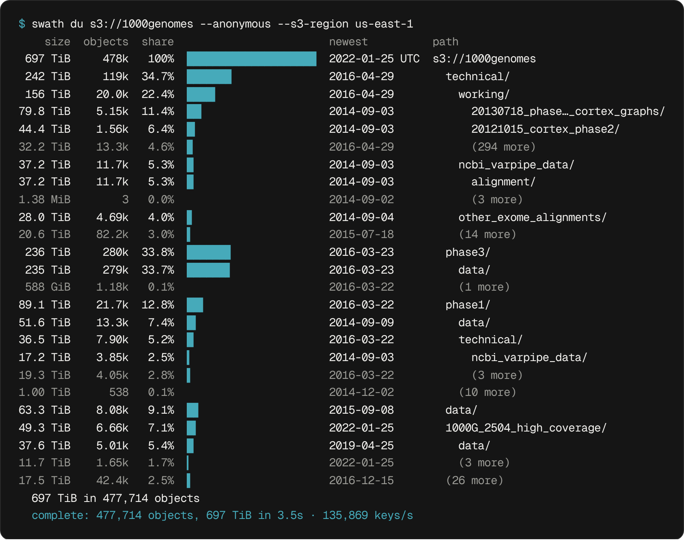

[](https://github.com/varveio/swath/actions/workflows/ci.yml)

# swath

**Parallel listing and inventory for object stores and filesystems.**

See what's taking up space in a bucket or a directory, and save a Parquet inventory you can query without
listing again. swath reads listing metadata only; it never reads, changes or deletes what it lists.



Where 697 TiB sits in a public genomics bucket: 477,714 objects totalled in 3.5 seconds on a 4-vCPU cloud VM
([how this was measured](docs/internals/measurements.md#the-home-pages-lead-view-1000genomes-2026-11-16)).

- `swath du` shows where the bytes are, or totals files and bytes per directory or prefix.
- `swath list` prints every entry as a table, TSV or JSON lines, or writes a sorted Parquet inventory with a
  manifest that records how complete it is.
- `swath du --from-dataset` totals a saved inventory again without listing.

Sources: Amazon S3 and S3-compatible stores, Google Cloud Storage, Azure Blob Storage, and local or mounted
filesystems ([what each supports](https://swath.varve.io/docs/sources/)).

## Install

Download swath 0.4.0 for Linux, macOS or Windows from the
[releases page](https://github.com/varveio/swath/releases) and put it on your `PATH` as
[Install](https://swath.varve.io/docs/install.html) describes, or run the image `ghcr.io/varveio/swath:0.4.0`.
swath is pre-1.0, so flags and schemas can still change between releases. To build from source with Go 1.26.3
or later:

```bash
git clone https://github.com/varveio/swath.git && cd swath && ./build.sh -o swath
```

The build leaves the binary at `./swath`; put it on your `PATH` (for example `install swath ~/.local/bin/`) to
run the examples as written.

## Try it

On a directory of yours, with no account or credentials (replace `~/Downloads` with any directory):

```bash
swath du ~/Downloads                               # where the bytes are, at any depth
swath list ~/Downloads -o downloads-inventory      # a sorted Parquet inventory
swath show downloads-inventory                     # what it holds and how complete it is
```

On a terminal, bare `swath du` shows the largest directories and files at any depth, each under its parent
with its share of the total; in a pipe it prints the total row only. `swath du -d 1` prints the totals of each
directory one level down instead, a table or TSV for scripts.

The same totals from the inventory, without listing again:

```bash
swath du --from-dataset downloads-inventory
```

On a public S3 prefix, without credentials:

```bash
swath du s3://noaa-gestofs-pds/stofs_2d_glo.20230113/ --anonymous --s3-region us-east-1
```

Listing a bucket makes billable API requests; credentials otherwise come from the provider's usual chain.

## When it fits

`du` and `find` answer most questions about a small directory, and a scheduled provider inventory costs less
when a daily or weekly report is fresh enough. swath divides the key space into ranges and lists them in
parallel, which matters once a bucket holds tens of millions of keys. In one live run with `--workers 2048`,
swath 0.4.0 wrote a sorted Parquet inventory of 1.09 billion S3 objects in 238 seconds, under four minutes, on
one 64-vCPU VM; a separate count-only run of the same bucket took 169 seconds
([how this was measured](docs/internals/measurements.md#the-same-bucket-on-64-vcpus-at-2048-workers-sentinel-cogs-2026-11-17);
[how many workers to use](https://swath.varve.io/docs/size-a-run.html#workers)).
[Start here](https://swath.varve.io/docs/start-here.html#when-swath-fits) compares the choices.

## Limits worth knowing

- Azure Blob Storage: flat namespaces only. An account with a hierarchical namespace (Data Lake Storage Gen2)
  is refused ([Sources](https://swath.varve.io/docs/sources/azure.html)).
- Only object-store runs that write a dataset resume; a directory listing, text output and `swath du` start
  over ([Stop, resume and refresh](https://swath.varve.io/docs/resume-and-refresh.html#stopping-and-resuming)).
- macOS binaries are not notarized yet, so Gatekeeper blocks a browser download until you clear its
  quarantine attribute ([Install](https://swath.varve.io/docs/install.html#macos)).

## Documentation

The documentation is at [swath.varve.io](https://swath.varve.io/):
[Start here](https://swath.varve.io/docs/start-here.html),
[Install](https://swath.varve.io/docs/install.html),
[Your first inventory](https://swath.varve.io/docs/first-inventory.html),
[Sources](https://swath.varve.io/docs/sources/),
[Commands](https://swath.varve.io/docs/commands/swath.html),
[Dataset](https://swath.varve.io/docs/dataset.html) and
[Troubleshooting](https://swath.varve.io/docs/troubleshooting.html).

To work on swath, read the [contributor documentation](docs/internals/README.md) and
[CONTRIBUTING.md](CONTRIBUTING.md).

## License

[Apache-2.0](LICENSE). swath is by [Varve](https://varve.io).
